# session-board

Claude Code の会話をいくつも並行して動かしていると、どのタブで何をしていたか、どのブランチと PR がどの作業のものか、何がやりかけで残っているかが分からなくなる。
session-board はターミナルのタブ、Claude Code の会話の記録、git、GitHub の PR を手元で集め、会話ごとの作業の一覧としてブラウザに出すツール。

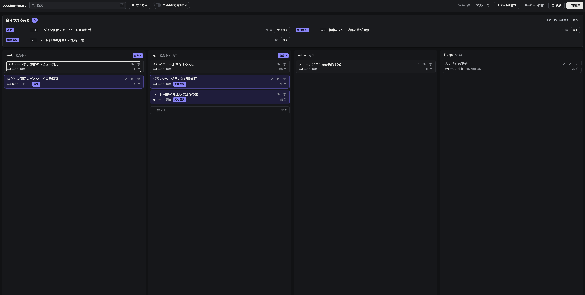

## できること

<details>
<summary><b>作業の一覧</b>: 会話 1 つを 1 件として、自分で決めた列（案件やリポジトリのまとまり）に並べる。自分が動く番の作業は、いちばん上にまとめる。</summary>

</details>

<details>
<summary><b>要約</b>: 会話ごとに、いまの状態、次の一手、作業の流れの図を出す。</summary>

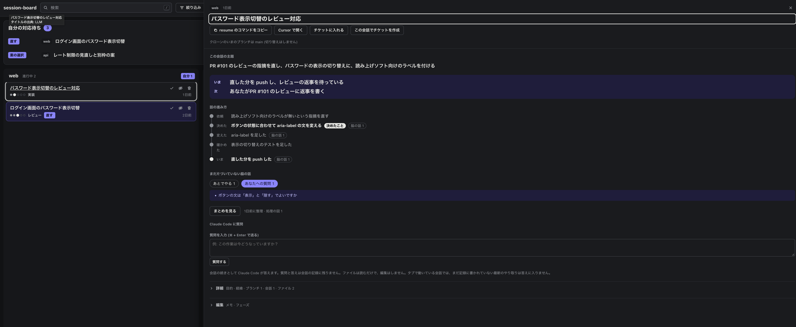

1. 一覧の行を押して、詳細パネルを開く
2. 上の「いま」と「次」で、作業がどこまで進んだかを見る
3. 「話の進み方」で、依頼から今までの流れを見る
4. 要約が古いときは、下の「詳細」を開いて「要約し直す」を押す

</details>

<details>
<summary><b>会話の履歴を可視化</b>: 返事が終わるたびに、依頼、決めたこと、残っている質問を 1 ページに整理する。</summary>

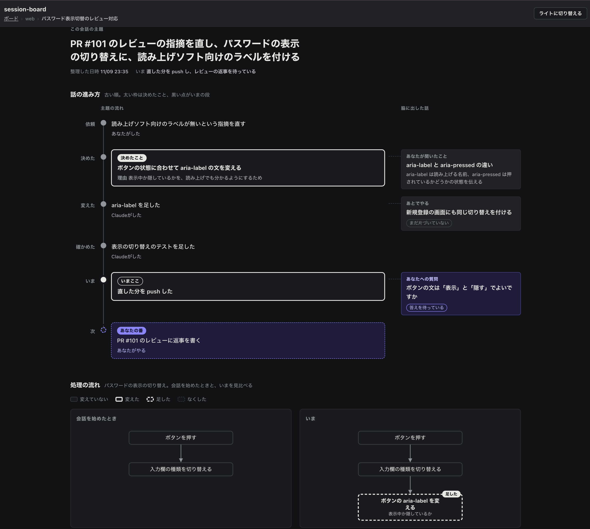

1. 先に、[会話のまとめを使う](#3-会話のまとめを使う-任意) のフックを登録しておく
2. 詳細パネルの「まとめを見る」を押すと、まとめのページが新しいタブで開く
3. 左の列で話の流れを、右の列で脇に出た話（あなたへの質問、あとでやることなど）を見る

</details>

<details>
<summary><b>質問</b>: 会話の続きとして Claude Code に質問できる。質問は会話の記録に残らない。</summary>

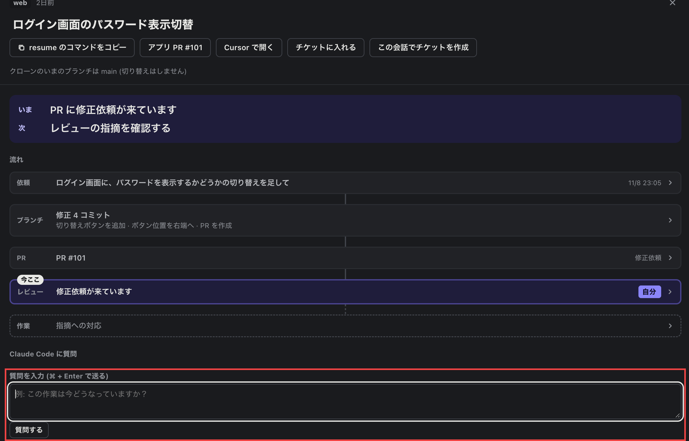

1. 詳細パネルの「Claude Code に質問」の欄に、質問を書く
2. 「質問する」を押すか、⌘ + Enter で送る
3. 答えが欄の下に出る。Claude Code はファイルを読むだけで、編集はしない
4. チケットの詳細パネルからも、同じ欄で質問できる。中の会話が 2 つ以上あるときは、「質問する会話」で相手の会話を選ぶ

</details>

<details>
<summary><b>チケット</b>: 同じ話の会話を、ドラッグ＆ドロップで 1 つにまとめる。</summary>

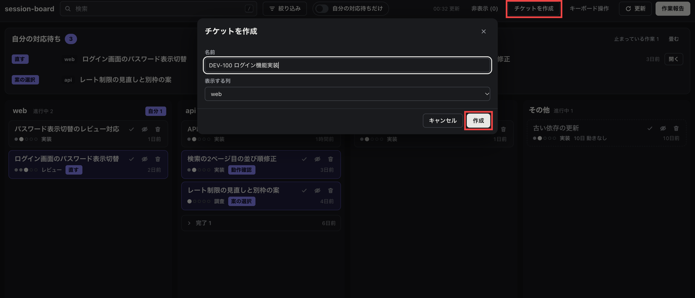

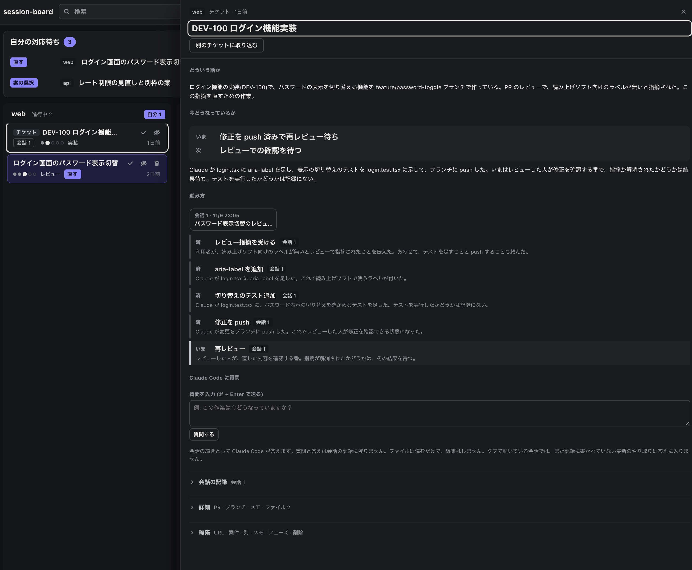

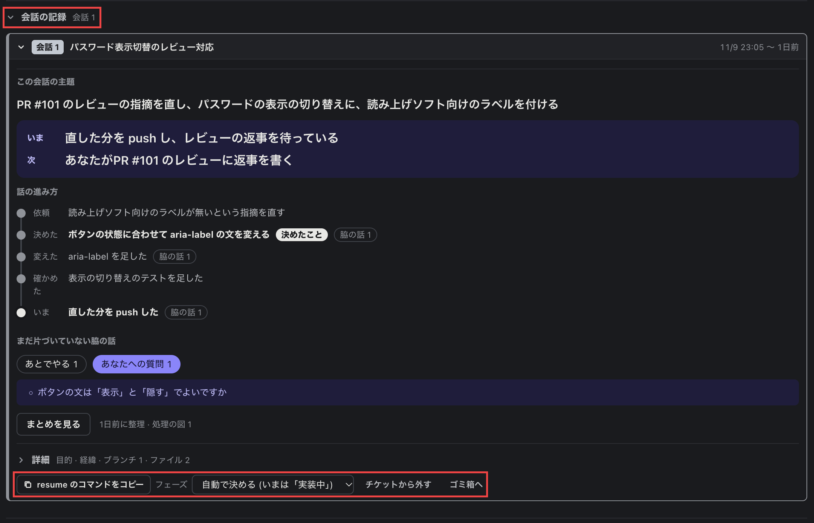

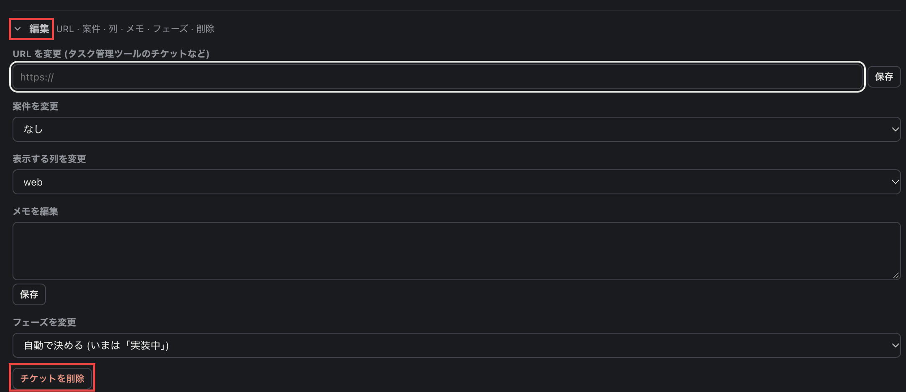

1. 会話の行を、別の会話の行にドラッグ＆ドロップする。チケットができて、2 つの会話が入る
2. 空のチケットから作るときは、ヘッダーの「チケットを作成」を押し、名前と表示する列を決めて「作成」を押す
3. チケットの行を押すと、話全体の要約（どういう話か、今どうなっているか、進み方）が出る
4. 「会話の記録」を開くと、中の会話ごとの要約と、resume のコマンドのコピー、チケットから外す操作がある
5. 「編集」で、URL、案件、表示する列、メモ、フェーズを変えたり、チケットを削除したりする

</details>

<details>
<summary><b>タブへ移動</b>: その会話のタブを前に出す。タブが閉じていれば、resume のコマンドをコピーする。</summary>

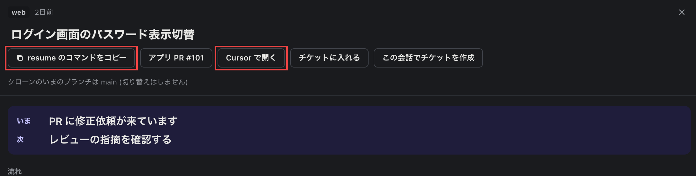

1. 一覧の行か詳細パネルで「タブへ移動」を押す（キーボードでは `t`）
2. タブが閉じているときは、ボタンが「resume のコマンドをコピー」に変わる。押してから、ターミナルに貼り付けて実行する
3. 作業の場所をエディタで開くときは、「Cursor で開く」を押す（キーボードでは `e`）。使うエディタは設定の `editor` で変えられる

</details>

<details>
<summary><b>片づけ</b>: 終わった作業を、完了、非表示、ゴミ箱へのどれかにする。</summary>

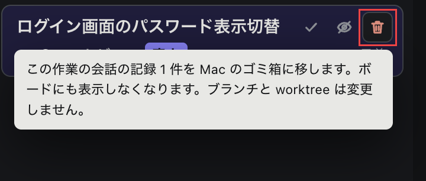

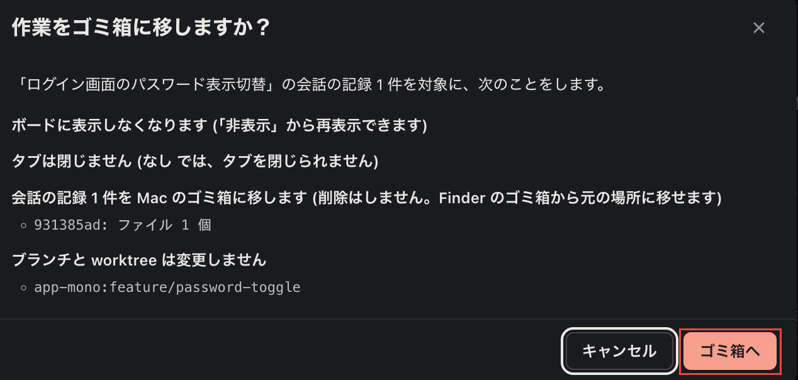

1. 各行の右上に、3 つのアイコンが並ぶ。✓ を押すと「完了」になり、列の下の「完了 N」にまとまる
2. 目のアイコンを押すと「非表示」になる。ヘッダーの「非表示 (N)」から戻せる
3. 完了と非表示は、押したあと 8 秒間出る「元に戻す」で取り消せる
4. ゴミ箱のアイコンを押すと、確認のダイアログが出る。「ゴミ箱へ」を押すと、タブを閉じて、会話の記録を Mac のゴミ箱に移す

</details>

<details>
<summary><b>作業報告</b>: その日の会話、PR、コミットから作業報告を作る。</summary>

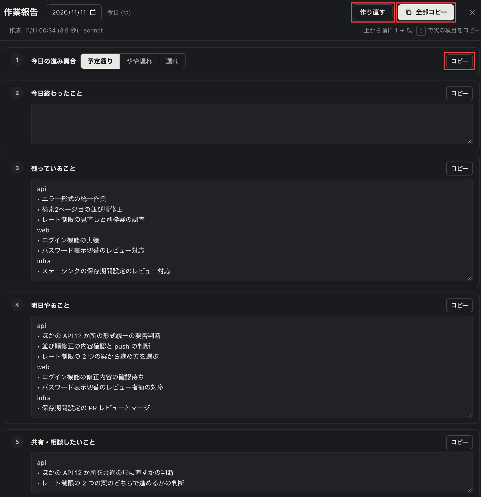

1. ヘッダーの右上の「作業報告」を押す。今日の報告を作り始める
2. ほかの日の報告は、上の日付を変えて作る
3. 項目ごとの「コピー」か、`c` キーで、上の項目から順にコピーしてチャットに貼る。まとめて貼るときは「全部コピー」を押す
4. 作り直すときは「作り直す」を押す

</details>

## 動く環境

- macOS
- Python 3.9 以上 (標準ライブラリだけを使う。pip でのインストールは要らない)
- [Claude Code](https://docs.claude.com/en/docs/claude-code) (`claude`)
- [GitHub CLI](https://cli.github.com/) (`gh`。`gh auth login` を済ませておく)
- タブを扱うターミナル: cmux、WezTerm、orca のどれか。実機で確かめたのは cmux だけ。ターミナルを使わない設定 (`none`) でも、タブまわり以外の機能は使える

## インストール

```sh
git clone <リポジトリの URL> session-board
cd session-board
./install.sh
```

`install.sh` は必要なコマンドがあるかを確かめ、例の設定を `~/.config/session-board/` にコピーし、`~/.local/bin/session-board` を作る。sudo は要らない。何度実行してもよい。アプリはこのフォルダから動かすので、フォルダはほかへ移さない (移したら `./install.sh` をやり直す)。

### 1. 追跡するリポジトリを書く

`~/.config/session-board/targets.json` に、追跡するリポジトリと、ボードの列を書く。いちばん小さい例は次のとおり。

```json
{
  "github_owner": "example-org",
  "repos": {
    "my-app": { "path": "~/src/my-app" }
  },
  "projects": [
    {
      "name": "my-app",
      "rules": [{ "repo": "my-app", "kind": "app", "paths": [""] }]
    }
  ]
}
```

`repos` に書いたリポジトリ (と、その worktree) の中で動いた会話だけがボードに出る。列を分けるルールなど、全部の項目は [docs/configuration.md](docs/configuration.md) にある。

### 2. 設定を確かめて起動する

```sh
session-board check    # 設定を確かめる。誤りがあれば、どこをどう直すかを出す
session-board          # 起動する
```

ブラウザで http://127.0.0.1:8765/ を開く。cmux を使うときは、cmux のタブの中で起動する (cmux は cmux の中から動いたプロセスからしか操作を受け付けないため)。

### 3. 会話のまとめを使う (任意)

会話のまとめは Claude Code の返事が終わったときに動くフック (Stop) から作る。`install.sh` はフックを登録しないので、`~/.claude/settings.json` に次を書き足す。`<session-board のフォルダ>` は、クローンした場所の絶対パスに置き換える。

```json
{
  "hooks": {
    "Stop": [
      {
        "hooks": [
          {
            "type": "command",
            "command": "PYTHONPATH=<session-board のフォルダ> python3 -m session_board.digest --hook"
          }
        ]
      }
    ]
  }
}
```

すでに `hooks` がある場合は、`Stop` の配列に 1 つ足す。フックは裏で処理を始めてすぐ終わるので、Claude Code の返事は遅くならない。

## よく変える設定

`~/.config/session-board/settings.json` に、変えたい項目だけを書く。

| 項目          | 既定値   | 説明                                                       |
| ------------- | -------- | ---------------------------------------------------------- |
| `terminal`    | `cmux`   | タブを扱うターミナル。`cmux` / `wezterm` / `orca` / `none` |
| `editor`      | `cursor` | 「エディタで開く」に使うコマンド (`code`、`zed` など)      |
| `port`        | `8765`   | 待ち受けるポート                                           |
| `window_days` | `21`     | これより古い会話・ブランチ・PR はボードに出さない (日数)   |
| `llm_enabled` | `true`   | 要約・会話のまとめ・作業報告に LLM を使うか                |
| `llm_model`   | `sonnet` | 要約に使うモデル                                           |

全部の項目は [docs/configuration.md](docs/configuration.md) にある。

## 更新と取り外し

```sh
cd <session-board のフォルダ> && git pull    # 更新する。動いているボードは止めてから起動し直す
./uninstall.sh                               # ~/.local/bin/session-board だけを消す
```

`uninstall.sh` は設定 (`~/.config/session-board/`) とデータ (`~/.local/share/session-board/`) を消さない。要らなければ手で消す。

## データの置き場所と外部への送信

| 種類                                                        | 置き場所                        | 変えるときの環境変数       |
| ----------------------------------------------------------- | ------------------------------- | -------------------------- |
| 設定                                                        | `~/.config/session-board/`      | `SESSION_BOARD_CONFIG_DIR` |
| データ (要約、チケット、手で付けたタイトルやメモ、作業報告) | `~/.local/share/session-board/` | `SESSION_BOARD_DATA_DIR`   |
| 読み取る Claude Code の記録                                 | `~/.claude/`                    | `CLAUDE_CONFIG_DIR`        |

- サーバーは 127.0.0.1 だけで待ち受ける。ほかの PC からは開けない
- 外に送るのは `gh` (GitHub から PR を読む) と `claude -p` (要約・会話のまとめ・作業報告・質問) だけ。`claude -p` は、使っている Claude の利用枠を消費する。LLM を使いたくなければ `llm_enabled` を `false` にする
- ターミナル、会話の記録、git は読むだけで、変えない。例外は「ゴミ箱へ」で、タブを閉じ、その作業の会話の記録をゴミ箱に移す (消しはしない)。ブランチと worktree には触らない

## 既知の制約

- macOS 向けに作っている。ほかの OS では試していない
- WezTerm と orca は実機で試していない。ドキュメントにある出力の形と、偽のコマンドでだけ確かめている
- cmux の「Needs input」はワークスペース単位でしか取れない。そのため、同じワークスペースで止まっている Claude のタブには、すべて「指示待ち」が付く
- 会話は自動ではチケットに入らない。チケットに入れるまでは、会話の数だけボードの行が増える
- `window_days` より前の会話は、チケットに入っていても一覧に出ない
- ある会話で PR を作り、別の会話でレビューの指摘を直したときは、PR は作ったほうの会話にだけ付く
- `gh pr list` で読むのは、自分が作った PR の直近 50 件だけ。他人の PR は、会話の中で触れていて、まだマージされていないか最近更新されたものだけが出る
